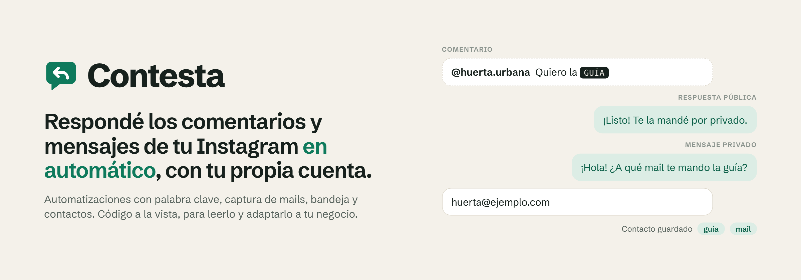
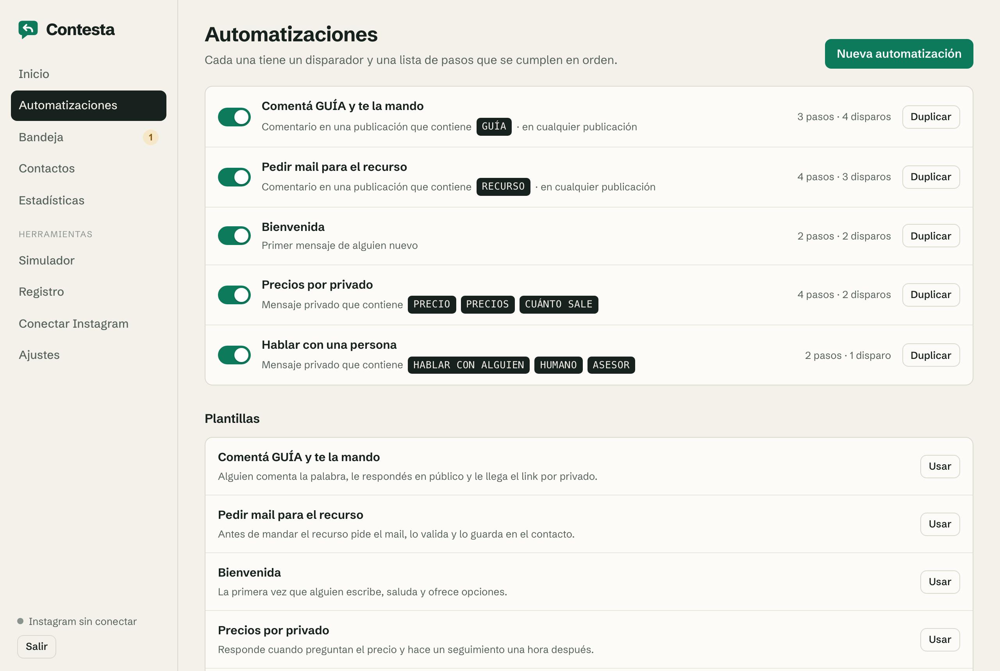
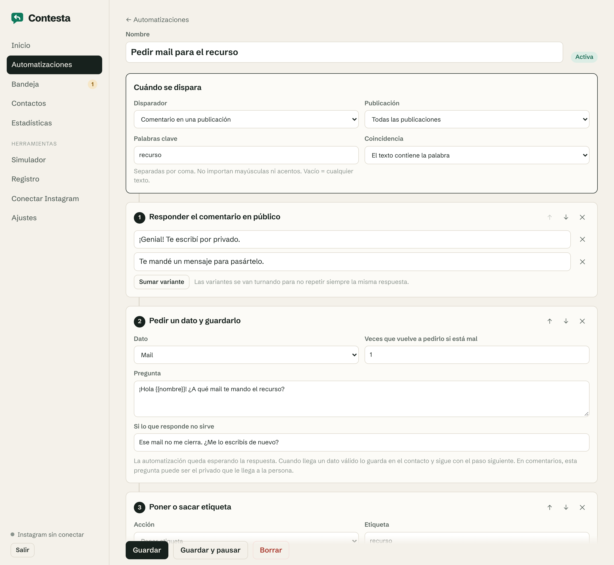
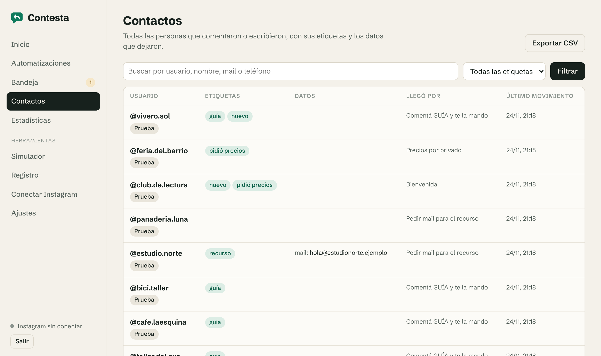
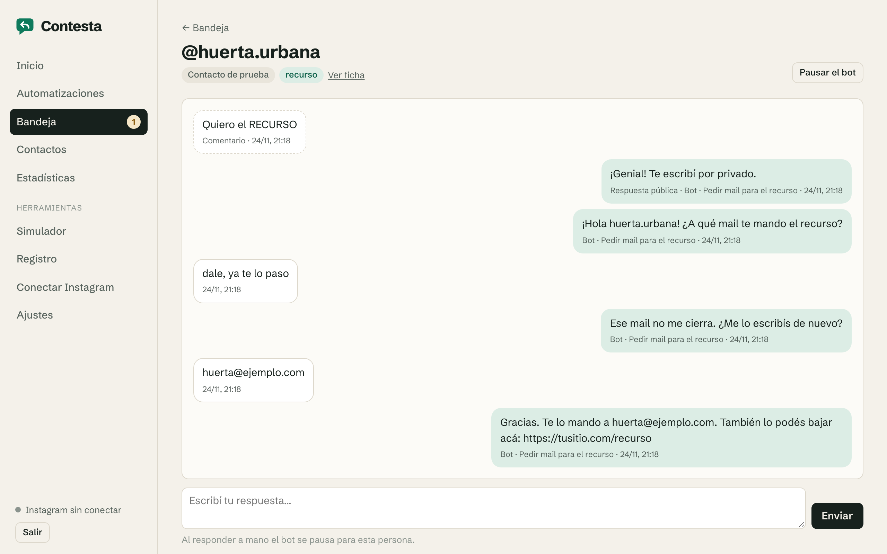
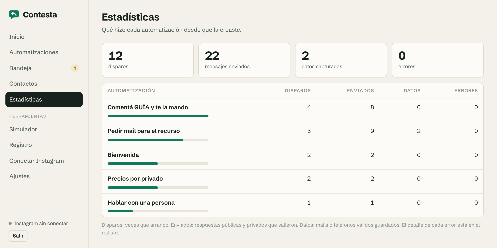
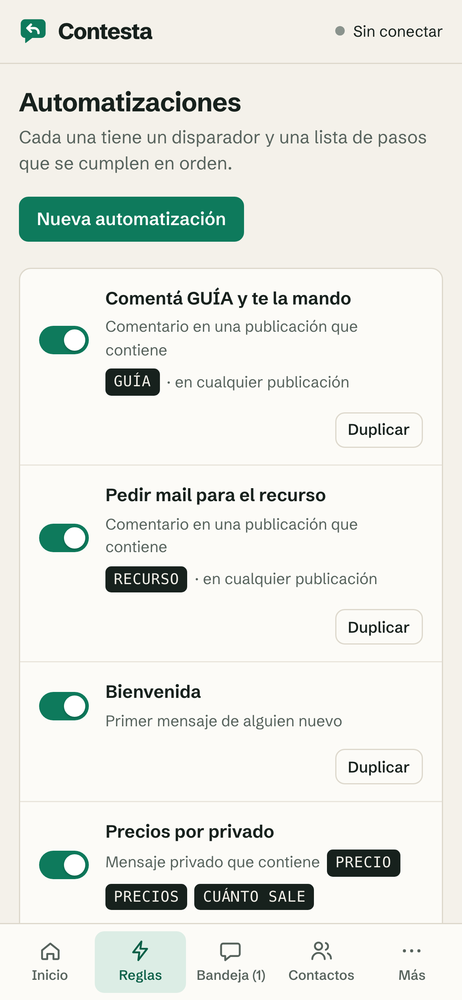
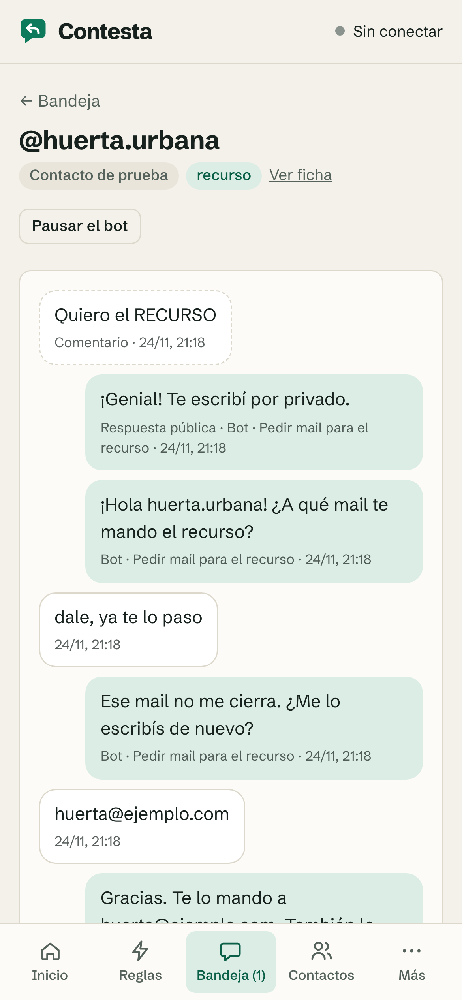
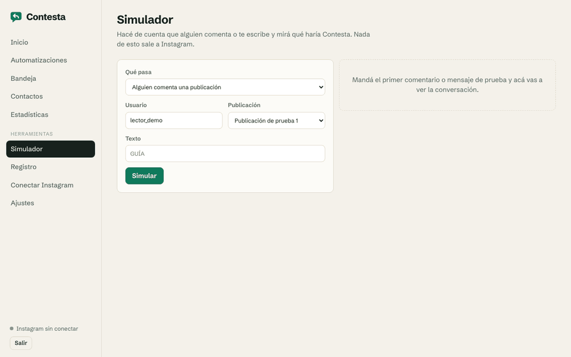
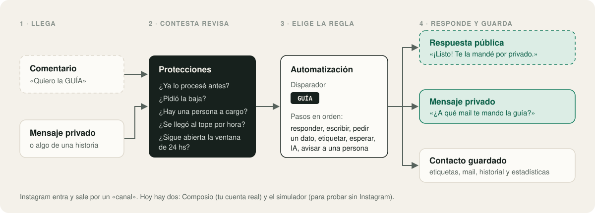

<p align="center">
  
</p>

# Contesta

Respuestas automáticas para los comentarios y mensajes de tu Instagram, en un panel propio que instalás con tu cuenta. Una alternativa propia a herramientas como ManyChat, pensada para leerla, entenderla y adaptarla a tu negocio.

<p align="center">
  
</p>

## Qué podés hacer

- **Automatizaciones** con un disparador y pasos en orden. Disparadores: comentario con palabra clave (en una publicación o en todas), mensaje privado con palabra clave, respuesta a una historia, mención en una historia y primer mensaje de alguien nuevo.
- **Pasos**: responder el comentario en público (con variantes que se turnan), mandar un privado, mandar un mensaje con botones, pedir un mail o un teléfono y guardarlo validado, poner o sacar etiquetas, esperar unos minutos, responder con IA y avisar a una persona.
- **Contactos** con etiquetas, datos capturados, de qué automatización llegaron, historial, buscador, filtro y exportación a CSV.
- **Bandeja** para responder a mano. Cuando respondés, el bot se pausa para esa persona.
- **Estadísticas** por automatización: disparos, mensajes enviados, datos capturados y errores.
- **Protecciones**: nunca responde dos veces lo mismo, respeta las reglas de Instagram, tiene tope de envíos por hora y palabra de baja.
- **Simulador** para probar todo sin tener Instagram conectado.

| Editor de una automatización | Contactos |
| --- | --- |
|  |  |

| Bandeja | Estadísticas |
| --- | --- |
|  |  |

<p align="center">
  
  &nbsp;&nbsp;
  
</p>

Todas las capturas son del panel real con datos de ejemplo cargados desde el simulador.

## Qué necesitás

- Una cuenta de Instagram **profesional** (de empresa o de creador). Las cuentas personales no sirven.
- Cuentas gratis de [GitHub](https://github.com), [Vercel](https://vercel.com), [Supabase](https://supabase.com) y [Composio](https://composio.dev).
- [Node.js](https://nodejs.org) 22 o más nuevo en tu compu. Funciona igual en Mac y en Windows.
- Opcional: una clave del AI Gateway de Vercel si querés el paso «Responder con IA».

Para probarlo en tu compu con el simulador no hace falta ninguna cuenta.

## Instalación

Está pensada para hacerla hablándole a Claude Code. Abrí la carpeta del proyecto y pedile: **«Instalá Contesta siguiendo el CLAUDE.md»**. Va a hacer estos mismos pasos y te va a pedir lo que necesite.

Si preferís hacerlo a mano:

1. **Bajá el proyecto e instalá.**
   ```
   git clone <la dirección de tu copia del repositorio>
   cd contesta
   npm install
   ```
2. **Creá tu configuración.** Esto arma el archivo `.env.local` y te muestra la clave para entrar al panel.
   ```
   npm run preparar
   ```
3. **Probalo en tu compu.** Abrí http://localhost:3000, entrá con la clave y andá al Simulador. Sin base configurada usa una local en la carpeta `.datos`.
   ```
   npm run dev
   ```
4. **Conectá la base de Supabase.** Creá un proyecto en Supabase, tocá «Connect», copiá la cadena de «Transaction pooler» y pegala en `DATABASE_URL` dentro de `.env.local` (reemplazando la contraseña). Después creá las tablas:
   ```
   npm run migrar
   ```
5. **Publicalo en Vercel.** Subí tu copia a GitHub, importala en Vercel y cargá las mismas variables de `.env.local` en «Environment Variables». Cuando termine, copiá la dirección de tu panel en `URL_PUBLICA` (en `.env.local` y en Vercel).
6. **Prendé el reloj.** Contesta necesita que algo lo despierte cada minuto para reanudar esperas y revisar Instagram. Lo hace tu misma base de Supabase, gratis:
   ```
   npm run programar
   ```
7. **Conectá Instagram.** Copiá tu clave de Composio en `COMPOSIO_API_KEY` (en Vercel, y volvé a desplegar). En el panel, entrá a «Conectar Instagram», tocá el botón y autorizá tu cuenta. Después tocá «Probar la conexión».

Todas las variables están explicadas en [`.env.example`](.env.example).

## Tu primera automatización

1. En **Automatizaciones**, elegí la plantilla «Comentá GUÍA y te la mando» y tocá **Usar**.
2. Cambiá las respuestas públicas y el mensaje privado, con tu link.
3. Tocá **Guardar y activar**.
4. Andá al **Simulador**, elegí «Alguien comenta una publicación», escribí `GUÍA` y tocá **Simular**. A la derecha ves la respuesta pública y el privado que saldrían.
5. Probá también un comentario sin la palabra, y escribir `BASTA` por privado, para ver las protecciones.

<p align="center">
  
</p>

En los mensajes podés usar `{{nombre}}`, `{{usuario}}`, `{{mail}}` y `{{telefono}}`.

## Cómo funciona

<p align="center">
  
</p>

- **Cómo se entera de lo nuevo.** Composio no avisa al instante de lo que pasa en Instagram, así que Contesta pregunta cada tantos minutos (10 por defecto, se cambia en Ajustes). Eso quiere decir que una respuesta puede tardar hasta ese tiempo en salir.
- **Canales.** Todo lo de Instagram pasa por una interfaz «canal» (`lib/canales/tipos.ts`) con dos implementaciones: Composio y el simulador. Las reglas no saben nada de Instagram, así que sumar otro canal no las toca.
- **El motor** (`lib/motor/motor.ts`) recibe cada evento, aplica las protecciones, elige la automatización más específica y corre sus pasos. Si hay una espera o falta un dato, la guarda y la retoma después.
- **La base** es Postgres en Supabase. Las tablas están en `supabase/migrations`.

Si varias automatizaciones coinciden con el mismo mensaje, corre una sola: gana la palabra exacta sobre «contiene», y cualquier palabra clave sobre «primer mensaje».

## Límites y reglas de Instagram

Estas reglas las pone Instagram, no Contesta. El panel las respeta solo:

- **Ventana de 24 horas.** Solo podés escribirle por privado a alguien dentro de las 24 horas desde su último mensaje. Pasado ese tiempo, el mensaje no sale y queda anotado en el Registro.
- **Un solo privado por comentario.** A quien comenta le podés mandar un único privado, hasta 7 días después. Para seguir la charla tiene que contestarte. Por eso conviene que ese primer mensaje termine con una pregunta.
- **No hay difusiones masivas.** No se puede mandar un mensaje a toda tu lista: Instagram no permite escribirle a nadie fuera de la ventana de 24 horas. Contesta no tiene esa función y no conviene buscarle la vuelta: es la forma más rápida de que te limiten la cuenta.
- **Respuestas públicas.** Hasta 300 caracteres, y no pueden ir todas en mayúsculas.
- **Baja.** Si alguien escribe `BASTA` (se cambia en Ajustes), no recibe nada más hasta que escriba `VOLVER`.
- **Tope por hora.** Por defecto 60 envíos del bot por hora. Lo que sobra espera su turno.

Límites de las cuentas gratis:

- **Composio**: 10.000 llamadas por mes. Revisar Instagram cada 10 minutos gasta unas 8.600 por mes, más una por cada respuesta. En «Conectar Instagram» ves cuántas llevás. Si consultás más seguido, se acaban antes de fin de mes.
- **Vercel**: el plan gratis no permite tareas programadas cada minuto. Por eso el reloj corre en Supabase.
- **Supabase**: pausa los proyectos gratis que pasan una semana sin uso. Con el reloj andando no pasa.

Funciones que dependen de tu cuenta y hay que probar antes de confiar:

- La **respuesta privada a un comentario** y los **botones** no están entre las herramientas de Instagram de Composio. Contesta los manda con la llamada directa de Composio a Instagram. La respuesta privada a un comentario se probó con una cuenta real (noviembre de 2026) y llegó; los botones todavía no se probaron. Si tu conexión no tiene ese permiso, el envío falla y lo ves en el Registro. Se apaga con `COMPOSIO_PROXY=0`.
- Las **respuestas y menciones en historias** se detectan solo si Instagram las incluye en los mensajes que devuelve.

## Problemas comunes

| Qué pasa | Qué revisar |
| --- | --- |
| No me deja entrar | La clave es el valor de `CLAVE_PANEL` en `.env.local` (o en Vercel). Si la cambiás en Vercel, volvé a desplegar. |
| «Falta DATABASE_URL» en Vercel | Cargá la variable en Vercel y volvé a desplegar. La base local solo existe en tu compu. |
| `npm run migrar` no conecta | Usá la cadena de «Transaction pooler» (puerto 6543) y revisá la contraseña. Si tiene símbolos raros, cambiala por una de letras y números. |
| Simulo y no pasa nada | La automatización tiene que estar activa y la palabra tiene que coincidir. El resultado aparece al lado del botón «Simular». |
| En Instagram no responde | Mirá «Conectar Instagram»: estado, última consulta y «Probar la conexión». Después el Registro. Acordate de que solo atiende lo que pasó después de conectar. |
| Tarda en responder | Es el tiempo entre consultas. Bajalo en Ajustes, sabiendo que gasta más llamadas de Composio. |
| Las esperas no avanzan | Falta el reloj: `npm run programar` en producción, o `npm run reloj` en tu compu. |
| «Fuera de ventana» en el Registro | Pasaron más de 24 horas desde el último mensaje de la persona. No es un error: es la regla de Instagram. |
| El paso de IA no hace nada | Falta `AI_GATEWAY_API_KEY`. Sin esa clave el paso se saltea. |

## Para quien quiera tocar el código

```
npm test               # tests del motor (base en memoria, sin nube)
npm run tipos          # revisa los tipos
npm run build          # compila
npm run prueba:panel   # recorre el panel con un navegador sin interfaz
npm run docs:img       # regenera las imágenes de este README
```

La primera vez que uses las dos últimas: `npx playwright install chromium`. Más detalles en [CONTRIBUTING.md](CONTRIBUTING.md) y en [CLAUDE.md](CLAUDE.md).

## Qué podés y qué no podés hacer

En lenguaje llano (esto no es asesoramiento legal; lo que vale es el texto de [LICENSE](LICENSE)):

**Podés**

- Usarlo gratis para tu negocio, tu marca o tus propias cuentas.
- Leer el código, modificarlo y adaptarlo a lo que necesites.
- Compartir tu versión, manteniendo la licencia y los avisos.

**No podés**

- Venderlo, ni tal cual ni modificado.
- Ofrecerlo como servicio pago a otros, ni cobrar por alojarlo o darle soporte cuando el valor de lo que cobrás viene de este programa.

La licencia es Apache 2.0 con la condición Commons Clause. Titular: Ruptive AI, 2026. Si querés hacer algo que no entra acá, escribinos.

## Hecho en el LAB AI

Contesta es uno de los ejemplos del LAB AI, el programa de Seba Chuffer donde armás con IA sistemas como este para tu trabajo. Si querés aprender a construir los tuyos: [labdeai.com](https://labdeai.com/?utm_source=github&utm_medium=repo&utm_campaign=contesta).
